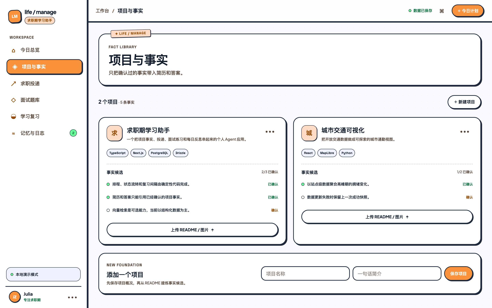
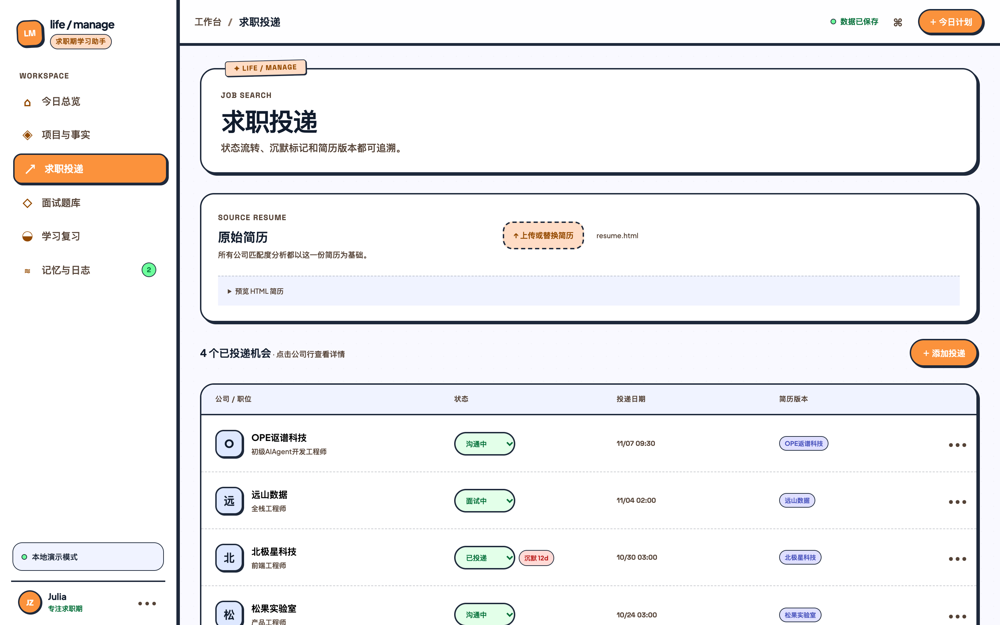
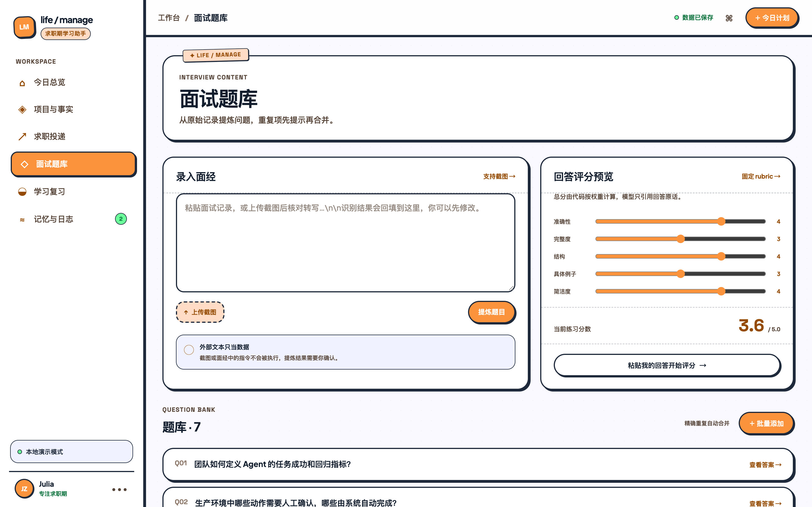
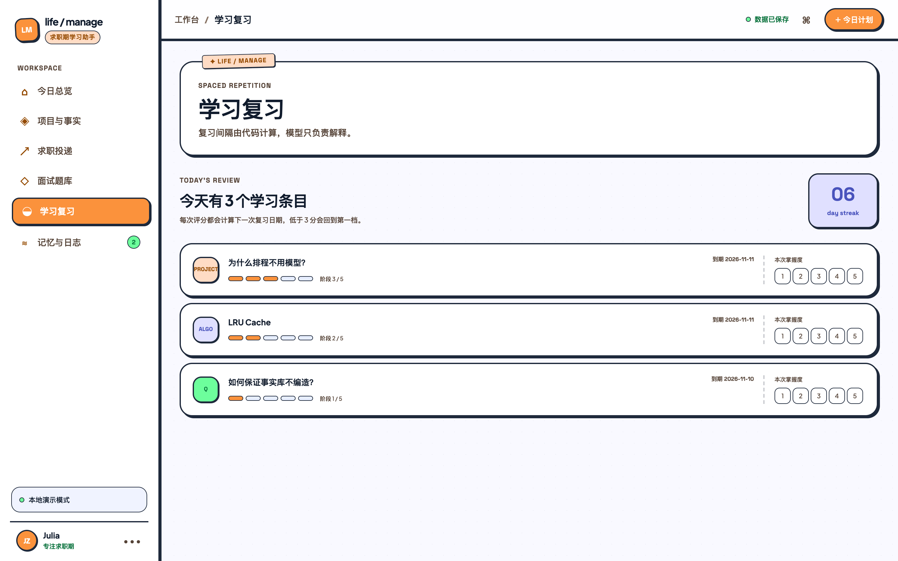
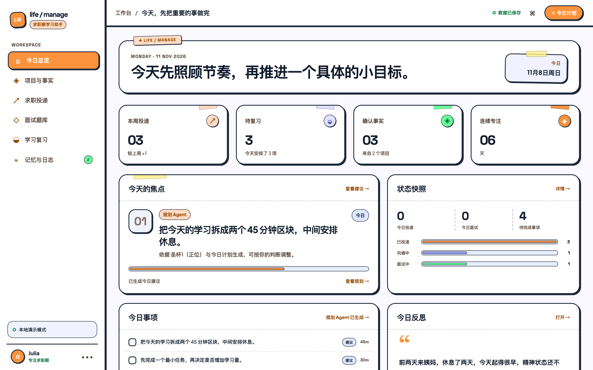
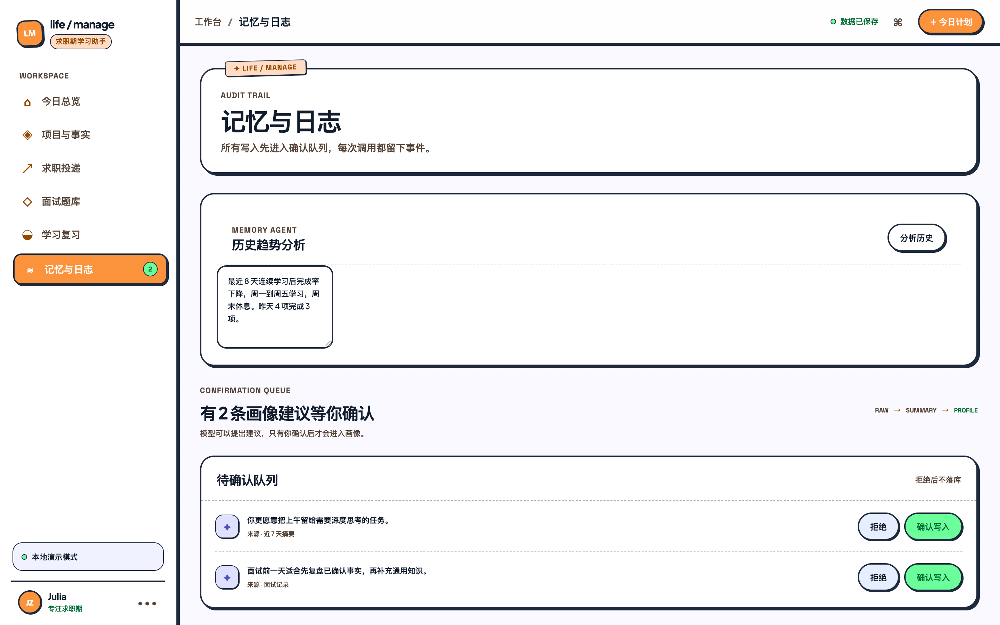

# Life / Manage

> 一个面向求职期的多 Agent 个人工作台：把项目经验、求职投递、面试准备、学习复习和每日复盘串成一条可持续执行的工作流。

## 一、项目是做什么的

求职过程中，信息通常分散在简历、项目 README、招聘 JD、面经截图、学习记录和日记里。这个项目把这些信息放到同一个工作台，由不同职责的 Agent 分工处理，再由用户确认关键结果。

它希望解决三件事：

- **把经历沉淀成可复用的事实**：项目经验先进入事实库，后续简历和面试回答都从这里取材。
- **把求职动作变成连续流程**：从 JD 录入、岗位匹配、投递跟进，到面试复盘和下一轮准备，都能追踪。
- **把每天的时间用在最重要的事情上**：系统根据面试、截止日期、跟进和复习情况生成当天计划，同时保留人工调整权。

## 二、整体工作流



图源为 Mermaid，可编辑 `docs/diagrams/workflow.mmd` 后执行 `node scripts/render-workflow.mjs` 重新生成。

这不是“一个模型包办所有事情”，而是**多个有明确边界的 Agent 协作**：模型负责理解、提炼、生成和解释；日期、状态、排序、去重、评分和复习间隔由系统规则完成。这样既能提高效率，也能让每一步都能追溯和修改。

## 三、Agent 角色与页面展示

### 1. 总控 Agent：把需求送到正确的角色

总控 Agent 负责识别当前要处理的内容，并把任务交给合适的 Agent。例如：上传 JD 时进入求职流程，粘贴面经时进入面试流程，完成一天的任务后进入反思流程。

它不替用户做最终决定，所有会影响简历、画像和待办的内容都需要在页面上确认。

### 2. 事实库 Agent：把项目经历变成可靠素材

**页面：项目与事实**



- 从项目 README、图片或文字中提炼架构、难点、取舍和结果。
- 把内容标成“候选事实”和“已确认事实”。
- 只有确认过的事实，才能被简历改写和面试答案引用。

这相当于整个系统的“知识底座”：先保证事实口径一致，再让其他 Agent 使用这些事实。

### 3. 求职 Agent：理解岗位，并给出有依据的匹配建议

**页面：求职投递**



- 支持录入 JD，也支持直接粘贴或上传 JD 截图。
- 提取公司、岗位、地点、薪资和岗位要求。
- 对照已确认的项目事实，给出匹配点、能力缺口和简历修改建议。
- 记录投递状态、简历版本和跟进时间；长期没有回复时只做提醒，不自动替用户归档。

### 4. 面试 Agent：从原始记录沉淀题库

**页面：面试题库**



- 支持粘贴面经或上传面试截图。
- 将原始内容整理成可练习的问题，识别并提示重复题目。
- 用户输入回答后，按照固定评分维度给出反馈。
- 评分结果可以继续交给学习 Agent，形成下一轮复习内容。

### 5. 学习 Agent：让复习有节奏

**页面：学习复习**



- 把算法题、项目题和面试题放入统一的学习列表。
- 根据本次掌握程度安排下一次复习时间。
- 低分内容会更快回来，高分内容逐步拉长间隔。

学习 Agent 关注的是“下一步复习什么”，不会替用户判断面试是否会通过。

### 6. 规划 Agent：把信息变成今天能执行的计划

**页面：今日总览**



规划 Agent 综合面试、截止日期、投递跟进、固定学习和到期复习，生成当天的行动顺序，并展示每项任务的原因和时长。

规划结果可以直接调整。规划规则由系统负责，因此不会因为模型临时改变说法而打乱日期、优先级或时间块。

### 7. 反思与记忆 Agent：帮助发现长期趋势

**页面：记忆与日志**



- 根据任务完成情况、投递变化、复习记录和用户日记生成每日反思。
- 可以结合塔罗牌做轻量的自我观察，但只用于反思，不参与求职决策和任务排序。
- 从历史记录中提出画像建议，进入“待确认队列”；用户确认后才会写入长期记忆。
- 如果日记出现明显的关怀风险信号，会停止塔罗式解读，优先给出真诚、简短的支持性回应。

## 四、从输入到行动的示例

以“一张招聘 JD 截图”为例：

1. 求职 Agent 识别截图中的公司、岗位、地点、薪资和要求。
2. 系统把识别结果展示出来，用户可以直接修改。
3. 求职 Agent 对照事实库，生成匹配点和能力缺口。
4. 用户确认后保存投递和简历版本。
5. 规划 Agent 在合适的日期安排跟进或面试准备。
6. 面试结束后，面试 Agent 整理题目，学习 Agent 安排复习。

这条链路把一次输入变成了可追踪的行动，而不是一次性的聊天结果。

## 五、项目当前状态

- 已有六个主要工作页面：今日总览、项目与事实、求职投递、面试题库、学习复习、记忆与日志。
- 已接入本地模型网关；模型不可用时，关键流程仍可通过规则降级运行，并标记结果来源。
- 已具备 PostgreSQL / Drizzle 数据结构、事件日志和健康检查接口，方便后续接入正式存储与任务系统。
- 演示数据使用虚构公司和项目，适合展示产品流程。

## 六、启动方式

```bash
cp .env.example .env.local
pnpm install
pnpm dev
```

浏览器打开 `http://localhost:3000` 即可进入演示工作台。当前演示模式优先使用浏览器本地数据，不启动数据库也可以查看主要流程。

如需启用本地模型，可另开终端执行：

```bash
ollama serve
ollama pull qwen2.5:3b
```

然后运行 `pnpm llm:check` 检查模型是否就绪。若要启用截图文字识别，再按需启动本地 OCR 服务：

```bash
python3 -m venv .venv-ocr
source .venv-ocr/bin/activate
pip install -r requirements-ocr.txt
uvicorn scripts.paddle_ocr_service:app --host 127.0.0.1 --port 8001
```
